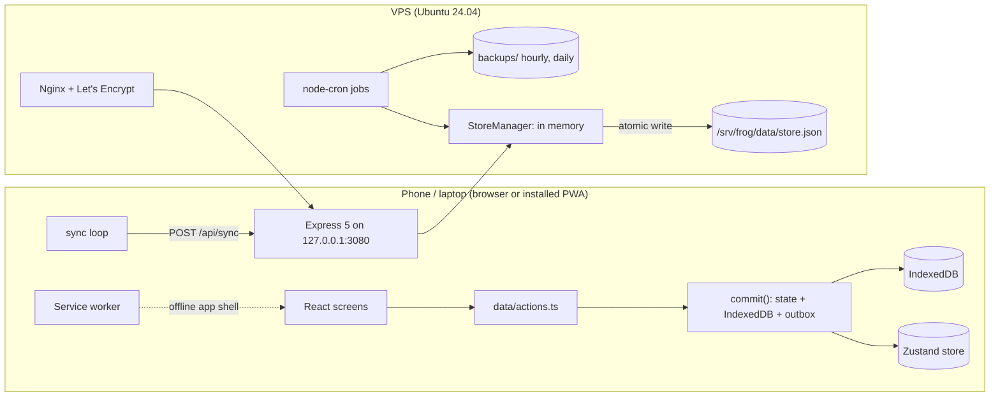

# Frog: Architecture

|                    |                                                                                                                                                         |
| ------------------ | ------------------------------------------------------------------------------------------------------------------------------------------------------- |
| **Last updated**   | 12 Oct 2026                                                                                                                                             |
| **Code**           | `github.com/emerue/Productivity-app` (`main`)                                                                                                           |
| **Companion docs** | [PRD.md](PRD.md) (what and why) · [../DECISIONS.md](../DECISIONS.md) (individual calls) · [../deploy/DEPLOY.md](../deploy/DEPLOY.md) (step-by-step ops) |

> **Keeping this current.** Update this file in the same commit as any change to the data model, sync, API, storage, deployment or a new module. Small "why" calls go in DECISIONS.md; this file describes how the system fits together _now_. Add a line to the [Changelog](#13-changelog).

---

## 1. Overview

Frog is an **offline-first PWA** with a **small sync server**. The phone or laptop holds a full copy of the data in IndexedDB and works without a network. Every edit is applied locally, queued in an outbox and sent to the server, which merges it into a single JSON file and hands back whatever changed elsewhere.



All domain rules (quadrants, dates, merge, quick add, repeats, suggestions) live in **`shared/`** and run identically on the client and the server.

## 2. Repository layout

```
package.json            npm workspaces: shared, server, client; root scripts
shared/src/             pure TypeScript, no I/O
  schema.ts             zod schemas + types (Store, Task, List, Day, Repeat…)
  dates.ts              YYYY-MM-DD arithmetic, logical day, planning window
  quadrant.ts           urgency, quadrant, flags for manual moves, due conflict
  tasks.ts              constructors and edits (complete, postpone, steps, completeRepeating);
                        patchTask keeps "a repeat has a due date" for every edit
  repeat.ts             occurrences, next due, labels, presets
  day.ts                Day module: membership, Frog ∉ myDay, edits, leftovers, todayPlan (My Day view)
  lists.ts              live lists, pickList (where a new task lands), nextListOrder
  commands.ts           task commands: (snapshot, clock, args) → { edit, undo?, outcome }
  suggestions.ts        deterministic score, ranking, Frog suggestion
  quickadd.ts           quick-add grammar
  merge.ts              entity merge rules, clamp future timestamps, applyChanges
  seed.ts               first-boot store (four lists, default settings)
server/src/
  index.ts              boot, signals (flush on SIGTERM)
  app.ts                Express app: /api routes, static client, headers
  auth.ts               signed-cookie session, login rate limit
  config.ts             env → config (dev defaults, prod requirements)
  store/manager.ts      in-memory store, sync, stamping, debounced atomic flush
  store/atomic.ts       tmp + fsync + rename
  store/backups.ts      hourly/daily/pre-import/pre-migration copies + pruning
  store/jobs.ts         cron: backups, tombstone purge, Drop auto-archive, 90-day archive
  migrations/index.ts   sequential schema migrations (none yet; v1)
  scripts/hash-password.ts
client/src/
  main.tsx  App.tsx     bootstrap, routes
  sw.ts                 service worker (Workbox precache + navigation fallback)
  data/                 store.ts (Zustand), db.ts (IndexedDB), syncEngine.ts (protocol), sync.ts (wiring),
                        api.ts, actions.ts (runs commands, toasts), ui.ts
  lib/                  time, sort, agenda, queries, keyboard, hooks, timer, wakeLock, sound, storage…
  components/           Shell, TaskRow, TaskDetail, TaskActions, QuickAdd, RepeatPicker, Modal/Sheet…
  screens/              MyDay, Agenda, Matrix, Lists, ListView, Focus, Plan, Settings, Login
  styles/               tokens.css, base, components, tasks, views, focus, plan, settings
deploy/                 deploy.sh (laptop), remote.sh (server), frog.service, nginx.conf.template
docs/                   PRD.md, ARCHITECTURE.md
DECISIONS.md PLAN.md    decision log, original milestone plan
```

## 3. Stack

| Layer      | Choice                                                                                       |
| ---------- | -------------------------------------------------------------------------------------------- |
| Language   | TypeScript (strict) everywhere                                                               |
| Client     | React 18, React Router 6, Zustand 5, `idb` (IndexedDB), dnd-kit, date-fns(-tz)               |
| PWA        | Vite 7 + `vite-plugin-pwa` (injectManifest), Workbox precaching/routing                      |
| Styling    | Plain CSS with design tokens; light/dark; no framework                                       |
| Server     | Node 22, Express 5, helmet, express-rate-limit, cookie-parser, bcrypt, node-cron             |
| Validation | zod 3 schemas in `shared` (server validates every sync and import)                           |
| Storage    | One JSON file (`store.json`) on the server; IndexedDB on each device                         |
| Tests      | Vitest (shared, server, client projects); browser flows with Playwright (see §10)            |
| Quality    | ESLint (typescript-eslint, react-hooks), Prettier                                            |
| Hosting    | Vultr VPS, Ubuntu 24.04, systemd, Nginx 1.24, Let's Encrypt via certbot, `sslip.io` hostname |

## 4. Data model

One **Store** document (`shared/src/schema.ts`, `SCHEMA_VERSION = 1`):

```
Store { schemaVersion, epoch, rev,
        lists: {id → List}, tasks: {id → Task}, days: {date → Day},
        focusSessions: {id → FocusSession}, settings: Settings, pushSubscriptions: [] }
```

| Entity           | Key fields                                                                                                                                                                                                                                                                                                     |
| ---------------- | -------------------------------------------------------------------------------------------------------------------------------------------------------------------------------------------------------------------------------------------------------------------------------------------------------------- |
| **List**         | `id l_…`, `name`, `order`, `updatedAt`, `rev`, tombstone (`deleted`, `deletedAt`, `restore`)                                                                                                                                                                                                                   |
| **Task**         | `id t_…`, `title`, `listId`, `important`, `urgentFlag`, `due` (date or null), `waitingOn`, `followUp`, `notes` + `notesUpdatedAt`, `subtasks[]` (own `updatedAt`), `status` open/done/archived, `createdAt`, `completedAt`, `updatedAt`, `rev`, `history[]` (append-only, capped at 100), `repeat?`, tombstone |
| **Repeat**       | `unit` day/week/month/year, `every` 1–365, `weekdays?` (0 = Sun), `anchor` date                                                                                                                                                                                                                                |
| **Day**          | `date`, `frog` (task id or null), `myDay[]` (other planned ids, never contains the frog), `planned`, `plannedAt`, `updatedAt`, `rev`                                                                                                                                                                           |
| **FocusSession** | `id f_…`, `taskId`, `start`, `plannedMinutes`, `actualMinutes`, `completed`, append-only                                                                                                                                                                                                                       |
| **Settings**     | plan time, day start hour, timezone, timer presets, urgency window, Drop archive days, default list, wake lock, sounds, theme                                                                                                                                                                                  |

Rules worth knowing:

- **Quadrant is derived, never stored.** `important` + (`urgentFlag` or due within `urgencyWindowDays`).
- **Dates are calendar strings** (`YYYY-MM-DD`) in the user's timezone. "Today" is the **logical date**: before `dayStartHour` (04:00) it is still yesterday.
- **Deletes are tombstones** (`deleted: true`), purged after 30 days. Undo of a delete is a restore (`restore: true`).
- **Ids** are prefixed nanoids (`t_`, `l_`, `s_`, `f_`, `h_`).
- **`epoch`** changes when the store is replaced by an import, so stale devices reload instead of merging old data back.

## 5. Sync

### Client side (`client/src/data/syncEngine.ts`, wired in `sync.ts`)

The engine takes its network (`SyncTransport`: HTTP in the app) and local storage (`SyncPersistence`: IndexedDB) as adapters. `server/test/sync-engine.test.ts` runs two engines against a real in-memory `StoreManager`.

1. Every edit goes through **`commit()`**: update the Zustand store, save the entity to IndexedDB, add `kind:key` to the **outbox** with a sequence number, schedule a sync in 1 s.
2. **`runSync()`** sends `{ sinceRev, epoch, changes }` where changes are the outbox entities, to `POST /api/sync`.
3. The response's changes are merged into local state (`applyChanges`, same merge as the server), saved to IndexedDB, `rev` updated, and outbox entries removed only if they weren't edited again in the meantime.
4. Sync also runs on `online`, when the tab becomes visible, and every 60 s while visible. `sync.settled` marks the first sync of the session (used so deep links wait for data).
5. **401** → "sign in again" banner (local data kept). **409** (epoch changed) → full reload from `/api/store`.

### Server side (`StoreManager.sync`)

1. Reject a stale epoch (409).
2. Clamp timestamps more than 5 minutes in the future.
3. Refuse a change set that would delete the last list.
4. Merge each entity; every entity that changed is **stamped** with `++store.rev`.
5. Return everything with `rev > sinceRev` (everything if the client claims a rev ahead of the server).

### Merge rules (`shared/src/merge.ts`)

Commutative and idempotent, so all devices converge regardless of order:

- Entities: last writer wins on `updatedAt`; ties broken by comparing sorted JSON.
- Tasks merge at three levels: scalar fields by `updatedAt`, `notes` by `notesUpdatedAt`, each step by its own `updatedAt`. History is a union.
- Tombstones beat edits; only a later `restore` brings an entity back.
- Focus sessions are append-only.

## 6. Client

- **Boot** (`boot()`): load IndexedDB snapshot → status `ready` (works offline) → start the sync loop. No local data and no network → `offlineNoData`; 401 → login screen.
- **State:** `useData` (Zustand) holds entities, settings, rev, epoch, outbox, sync state. `useUI` holds ephemeral UI state (toasts, open sheets, selection, confirm dialog).
- **Writes:** every edit is a **task command** in `shared/commands.ts`: a pure function of a store snapshot and a clock that returns the entities to write, an optional `undo` (a function of the snapshot at undo time) and what the UI needs to say (conflict, next due date, full day). `data/actions.ts` runs the command, calls `commit()` and shows the toast. Screens never mutate state directly.
- **Reads:** `shared/day.ts` (`todayPlan`, `isInDay`, `leftovers`) for anything about a Day; `lib/queries.ts` for `useUrgency()` (one source for today + urgency window), `rankByQuadrant`, search, closed and overdue lists.
- **Routing** (`App.tsx`): `/` My Day, `/agenda`, `/matrix`, `/matrix/:quadrant`, `/lists`, `/lists/:id` (also `completed`, `archived`), `/settings`, `/plan`, `/focus/:taskId`, `/login`. The task panel is `?task=<id>` on any route.
- **Layout:** `Shell` = sidebar (desktop ≥1024 px) or tab bar (phone), main column, task panel (desktop right panel / phone bottom sheet), quick add, toasts, sheets. Sticky screen tops; long secondary lists in capped `.scroll-box`es.
- **Quick add** (`components/QuickAdd.tsx`): a `<form>`; defaults from the route (list, My Day, Agenda date); `parseQuickAdd` tokens override.
- **Agenda** (`lib/agenda.ts`): `buildAgenda(start, count, tasks, days)` → per day: due, planned, follow-ups, and `upcoming` repeat previews.
- **Offline shell** (`sw.ts`): precache built assets, fonts and icons; navigation falls back to `index.html`; `/api` is never cached. A waiting service worker triggers the "update ready" toast.
- **Per-device conveniences** in `localStorage` (`frog.*`): list sort, theme, hints. Never data.

## 7. Server

### API (`server/src/app.ts`, all JSON, `Cache-Control: no-store`)

| Method | Path           | Auth                                        | Purpose                                                             |
| ------ | -------------- | ------------------------------------------- | ------------------------------------------------------------------- |
| GET    | `/api/health`  | no                                          | `{ ok, rev, version }` for deploy checks                            |
| POST   | `/api/login`   | no (rate-limited: 5 failures / 15 min / IP) | password → signed session cookie                                    |
| POST   | `/api/logout`  | no                                          | clear cookie                                                        |
| GET    | `/api/session` | yes                                         | check session                                                       |
| GET    | `/api/store`   | yes                                         | full store (first load, epoch change)                               |
| POST   | `/api/sync`    | yes                                         | push changes, get changes since rev                                 |
| GET    | `/api/export`  | yes                                         | download the store as JSON                                          |
| POST   | `/api/import`  | yes                                         | replace the store (validated, migrated, backed up first, new epoch) |

Everything else serves the built client: hashed `assets/` immutable for a year; `index.html`, `sw.js` and the manifest never cached.

### Persistence

- The store lives in memory; each change marks it dirty and a **debounced flush** (500 ms) writes it **atomically** (tmp file, fsync, rename) on a single promise chain. SIGTERM flushes before exit.
- Boot: remove a leftover `.tmp`, run migrations (backing up first), validate with zod, refuse to start on an invalid store.

### Jobs (`store/jobs.ts`, in the store's timezone)

| When              | Job                                                                                                                                         |
| ----------------- | ------------------------------------------------------------------------------------------------------------------------------------------- |
| Every hour        | Backup → `backups/hourly/` (keep 48)                                                                                                        |
| 03:00             | Backup → `backups/daily/` (keep 30)                                                                                                         |
| 03:10 and at boot | Purge tombstones older than 30 days; archive tasks left in Drop for 14 days; move completed tasks older than 90 days to `archive/YYYY.json` |

### Auth and security

- Single password (bcrypt hash in env). Stateless signed cookie with an expiry, renewed when under 60 days remain; rotating `SESSION_SECRET` signs out every device.
- helmet headers + a strict CSP (Nginx adds HSTS and its own headers).
- Production refuses to start without `PASSWORD_HASH` and a 32+ character `SESSION_SECRET`.

## 8. Domain logic (in `shared/`)

- **Urgency / quadrant** (`quadrant.ts`): urgent = `urgentFlag` or due ≤ today + window (overdue included). Manual moves set flags; moving to Schedule/Drop while the date keeps it urgent raises a due conflict.
- **Score** (`suggestions.ts`, never shown): Do 40, Schedule 25; +15 Delegate follow-up due; +20 due on the target day, +25 overdue; +10 carried forward; +3 per postponement (max 12); +5 has a next step. Ties: earlier due, then older. Used for ordering, planning suggestions and the suggested Frog.
- **Quick add** (`quickadd.ts`): tokens anywhere, last one wins: `@list`, `^date`, `!u`, `!n`, `!i`, `+`, `>Name`, `*repeat`.
- **Repeats** (`repeat.ts`): occurrences counted from `anchor` (monthly/yearly clamp to month end without drifting). `completeRepeating` marks the task done (`repeat: null`) and creates the next one due at `nextDue` (first occurrence after the old due date that isn't in the past). The Agenda previews `isOccurrence` dates after the live task's due date.

## 9. Deployment and operations

Built and tested on the laptop; the VPS only receives the finished app. Full steps: [deploy/DEPLOY.md](../deploy/DEPLOY.md).

| Command (laptop, repo root)                                               | Does                                                                                                                                 |
| ------------------------------------------------------------------------- | ------------------------------------------------------------------------------------------------------------------------------------ |
| `deploy/deploy.sh`                                                        | build, typecheck, test, package (~400 KB), upload, install runtime deps, switch release, health check, automatic rollback on failure |
| `deploy/deploy.sh status` / `rollback` / `password` / `tunnel` / `backup` | service state · previous release · set password (hashed locally) · use over SSH · copy daily backups to the laptop                   |
| `deploy/deploy.sh https <domain> [email]`                                 | certificate + Nginx site                                                                                                             |

Server layout:

```
/srv/frog/.env                 PORT, DATA_DIR, TZ, SESSION_SECRET, PASSWORD_HASH (root, 600)
/srv/frog/app -> releases/<utc-stamp>-<commit>   (last 5 kept)
/srv/frog/data/store.json      the data (frog user, 700 dir)
/srv/frog/data/backups/        hourly/, daily/, pre-import, pre-migration copies
/srv/frog/data/archive/        YYYY.json (completed > 90 days)
```

- **Process:** `frog.service` (systemd), user `frog`, `127.0.0.1:3080`, `MemoryMax=300M` (about 80 MB used), sandboxed, restarts on failure. Logs: `journalctl -u frog -f`.
- **Web:** Nginx site `frog` for `frog.45-77-62-61.sslip.io` (HTTP→HTTPS, proxy, gzip, cache rules, security headers). The other site on the box (`45-77-62-61.sslip.io`) is untouched. Certbot renews automatically.
- **Shared box:** the VPS also runs Python bots (`selfbot2`, `selfbot3`) in `screen`, restarted weekly by `selfbot2-restart.timer` / `selfbot3-restart.timer` (Sunday 10:00 Lagos). Frog's memory cap protects them.
- **Server address** lives in git-ignored `deploy/deploy.env`; never commit it.

## 10. Testing

| Suite                                                                                                                                              | Where                                               | Runs       |
| -------------------------------------------------------------------------------------------------------------------------------------------------- | --------------------------------------------------- | ---------- |
| Shared logic (dates, quadrant, merge, quick add, suggestions, repeats)                                                                             | `shared/test`                                       | `npm test` |
| Server (API and auth, store manager and persistence, jobs)                                                                                         | `server/test`                                       | `npm test` |
| Client logic (dates/format, timer, agenda, sort)                                                                                                   | `client/test`                                       | `npm test` |
| Browser flows (desktop 1280 px and phone 390 px): capture, actions, Agenda, lists, planning, Focus, settings, sign-out, sorting/scrolling, repeats | Playwright scripts, currently kept outside the repo | manual     |

`deploy.sh` refuses to ship unless build, typecheck and `npm test` pass. **To do:** move the browser flows into the repo (`e2e/`) with an `npm run e2e` script so they grow with the app (PRD backlog #8).

## 11. How to extend

**Add a field to a task**

1. `shared/src/schema.ts`: add it to `TaskSchema`. Make it `.optional()` (old stores and old clients keep working) or write a migration.
2. If users edit it, allow it in `patchTask` (`shared/src/tasks.ts`). Merge needs nothing: scalars merge by `updatedAt`.
3. Use it through an action in `client/src/data/actions.ts`, then the UI.
4. Tests in `shared/test`; update §4 here and the PRD.

**Change the stored shape (breaking)**
Bump `SCHEMA_VERSION`, append a migration in `server/src/migrations/index.ts` (never edit old ones). The server backs up before migrating. Older clients will receive the new shape, so keep the client tolerant.

**Add a screen**
Component in `client/src/screens/`, route in `App.tsx`, nav entry in `Shell.tsx` (`NAV`) if it's a tab, styles in `styles/views.css`. Use `.screen-top` for the sticky header and `.scroll-box` for long secondary lists.

**Add a quick-add token**
Token kind and parsing in `shared/src/quickadd.ts`, chip label in `QuickAdd.tsx`, apply it in `createFromQuickAdd`, tests in `shared/test`.

**Ship**
`npm test && npm run typecheck && npm run lint` → commit (update PRD/ARCHITECTURE changelogs) → `git push` → `deploy/deploy.sh`.

## 12. Known limits and risks

- **Single JSON file** suits one user (tens of thousands of tasks). Many users or attachments would need a database.
- **No time-of-day** on tasks, so no timed reminders; `pushSubscriptions` is reserved but unused.
- **Clock skew** across devices is clamped (+5 min) but last-writer-wins can still pick a stale edit from a device with a slow clock.
- **Shared 1 GB VPS:** Frog is capped at 300 MB; the bots are the main memory users.
- **Browser flow tests** aren't in the repo yet, so regressions in UI flows are only caught when they're run manually.

## 13. Changelog

| Date       | Change                                                                                                                                                                                                                                          |
| ---------- | ----------------------------------------------------------------------------------------------------------------------------------------------------------------------------------------------------------------------------------------------- |
| 2026-10-12 | Task commands (`shared/commands.ts`), Day module (`shared/day.ts`), `shared/lists.ts`; client sync split into `syncEngine.ts` (adapters) + `sync.ts`; `lib/queries.ts`. Repeat rule enforced in `patchTask`. Drop auto-archive job clears Days. |
| 2026-10-03 | Repeat model (`Task.repeat`, `shared/repeat.ts`, `completeRepeating`, Agenda `upcoming`). This document created.                                                                                                                                |
| 2026-09-30 | Quick add is a `<form>`; phone sheet button submits via `requestSubmit` (fallback for iOS < 16).                                                                                                                                                |
| 2026-09-29 | `lib/sort.ts`, sticky `.screen-top`, `.scroll-box`; `sync.settled` for deep links.                                                                                                                                                              |
| 2026-09-28 | `TaskActions` sheet, Agenda screen (`lib/agenda.ts`), quick-add defaults; deployed to the VPS (systemd, Nginx, certbot on sslip.io).                                                                                                            |
| 2026-09    | V1 (M0–M9): shared logic, server persistence and sync, offline client, PWA, deploy scripts.                                                                                                                                                     |
